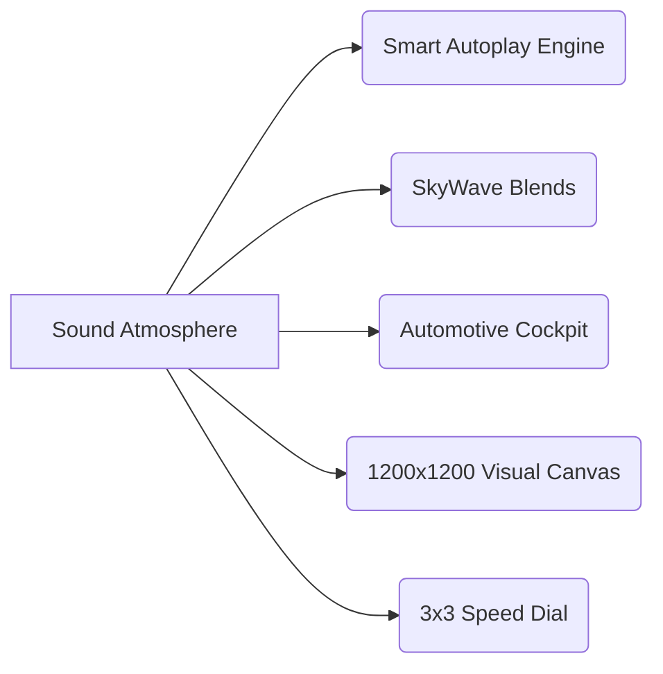

# 🌊 SkyWave

<div align="center">

```
   _____ _          __          __                
  / ____| |         \ \        / /                
 | (___ | | ___   _  \ \  /\  / /_ ___   _____    
  \___ \| |/ / | | |  \ \/  \/ / _` \ \ / / _ \   
  ____) |   <| |_| |   \  /\  / (_| |\ V /  __/   
 |_____/|_|\_\\__, |    \/  \/ \__,_| \_/ \___|   
               __/ |                              
              |___/                               
```

**Next-Generation Personal Audio System & Collaborative Sound Engine**

[](https://kotlinlang.org/)
[](https://developer.android.com/jetpack/compose)
[](https://developer.android.com/guide/topics/media/media3)
[](https://android.com/auto)
[](#)

<br/>

> *"Music isn’t just playback. It’s an intuition."*

</div>

---

## 🔮 What is SkyWave?

SkyWave isn't another generic music player. It is a carefully engineered **sound atmosphere** built to bridge pure aesthetic beauty, intuitive social listening, and uncompromising performance.

From effortless **two-mind playlist blending** to an **integrated cockpit Android Auto system**, SkyWave anticipates what you want to hear next without you ever touching a dial.

---

## ✨ Features That Set SkyWave Apart



### ⚡ 1. The Autonomous Flow Engine
* **Intuitive Taste Follow-Up**: Pick a single song, lock your screen, and let SkyWave's continuous curation take over. The engine analyzes sonic textures, tempo, and mood to queue up the next perfect track seamlessly.
* **Intelligent Background Prefetching**: Eliminates waiting and buffering. The player pre-resolves upcoming streams in the background so track skips are instant.
* **Full Up-Next Freedom**: Drag, reorder, draw up, or clear upcoming tracks with smooth gesture controls.

### 🎨 2. Ultra-HD Studio Artwork Engine
* Standard audio apps compromise visual quality with downscaled, pixelated covers. SkyWave introduces a native clarity pipeline delivering **lossless 1200×1200 studio-grade cover art**.
* Dynamic color adaptation extracts complementary ambient palettes from the artwork for an immersive, edge-to-edge dark aesthetic.

### 👥 3. SkyWave Blends — Collaborative Chemistry
* **Two Users, One Unified Mix**: Connect with a friend via an exclusive blend code. Your musical frequencies merge into a single shared space.
* **Independent Curation**: Add songs on your own terms. Use the multi-select tool inside your library to batch-send your hand-picked favorites straight into the active Blend.
* **Real-time Synchronized Space**: When either listener adds or removes a song, the playlist updates smoothly in real time without screen flickers or awkward reloads.

### 🚗 4. Automotive-Grade In-Car Experience (Android Auto)
* **Distraction-Free Cockpit UI**: Designed to deliver an Apple Music / premium in-car feel with zero lag.
* **Steering-Wheel Media Command Sync**: Native hardware key binding for responsive next/previous/play/pause control.
* **Car Dashboard Speed Dial**: 9 instantaneous quick picks accessible on your in-dash screen so your eyes stay on the road.
* **Voice-Powered Navigation**: Speak to your vehicle to command tracks, artists, or albums hands-free.
* **Seamless Audio Focus**: Gracefully handles incoming phone calls, vehicle chime interruptions, and GPS navigation voiceovers.

### 🎯 5. 3×3 Home Speed Dial
* Instant muscle-memory music launching right from the home screen. A dynamic 9-tile grid maps to your frequent rotations, mood shifts, and daily listening habits.

---

## 🛠️ Architecture & Under The Hood

SkyWave is developed using the latest modern Android development (MAD) guidelines:

```
┌────────────────────────────────────────────────────────┐
│                      SkyWave UI                        │
│   Jetpack Compose • Material 3 • Palette API • Coil    │
├────────────────────────────────────────────────────────┤
│                 Domain & Use Cases                     │
│    Clean Architecture • Unidirectional Data Flow       │
├────────────────────────────────────────────────────────┤
│                 Audio Orchestrator                     │
│   Media3 MediaLibraryService • ForwardingPlayer        │
│          ExoPlayer Core • System Audio Focus           │
├────────────────────────────────────────────────────────┤
│                 Persistence & Cache                    │
│      Room DB • Encrypted DataStore • Memory Caches     │
└────────────────────────────────────────────────────────┘
```

* **Modern Stack**: 100% Kotlin with Declarative Jetpack Compose.
* **Reliable Background Execution**: Foreground `MediaLibraryService` with battery-friendly background lifecycle management.
* **Zero ANR Design**: Thread-confined ExoPlayer control, non-blocking coroutines, and structured task cancellation.
* **Strict Privacy First**: Local metadata persistence with isolated, secure syncing.

---

## 🔒 How to Get SkyWave

> [!IMPORTANT]
> **SkyWave is currently distributed exclusively through a Private Access Program.**

The public distribution build is not hosted openly to preserve service performance and curated invite rollouts.

### Ready to elevate your sound experience?
To obtain the latest verified build (`.apk`) and generate your access key:

📩 **Contact the Project Admin directly** to request early access onboarding.

---

## 🎮 Sneak Peek

| 🎧 Full Player Experience | 👥 Social Blends | 🚗 In-Car Cockpit |
| :---: | :---: | :---: |
| Dynamic ambient canvas & studio cover clarity | Collaborative realtime taste mix | Complete vehicle dashboard integration |

---

<div align="center">

Crafted with passion for sound perfection.  
**SkyWave © 2026**

</div>

