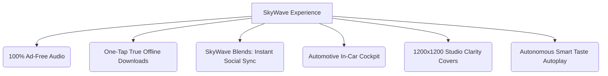

# 🌊 SkyWave

<div align="center">

```
   _____ _          __          __                
  / ____| |         \ \        / /                
 | (___ | | ___   _  \ \  /\  / /_ ___   _____    
  \___ \| |/ / | | |  \ \/  \/ / _` \ \ / / _ \   
  ____) |   <| |_| |   \  /\  / (_| |\ V /  __/   
 |_____/|_|\_\\__, |    \/  \/ \__,_| \_/ \___|   
               __/ |                              
              |___/                               
```

**Zero Ads. Zero Limits. Uncompromised Sound & Real-Time Collaborative Flow.**

[](#-get-the-beta--share-your-review)
[](#)
[](#)
[](#)
[](#)

<br/>

> *"Tired of apps treating music like a commercial break? We built SkyWave to bring back pure, uninterrupted listening."*

</div>

---

## 💥 Why Choose SkyWave? (Tired of The Usual Nonsense?)

If you listen to music every single day, you already know the frustration:
* 😤 **Loud, jarring ads** cutting in right as the beat is about to drop.
* 🔒 **Skip penalties & paywalls** telling you how many tracks you're allowed to skip per hour.
* 📉 **Restricted offline access** that locks your music behind monthly subscriptions.
* 🐌 **Bloated, sluggish apps** packed with podcasts and promotions you never asked for.

**SkyWave flips the script completely.**  
No paywalls. No interruptions. No restrictions. Just pure, instant sonic freedom. It only takes one session to realize why **it's 100% worth a shot**.

---

## 🎁 What You Get with SkyWave



### 🚫 1. 100% Ad-Free & Limitless Skips
Zero commercials. Zero banner interruptions. Skip as many tracks as you want, scrub anywhere, anytime.

### 📥 2. One-Tap Offline Freedom
Download any track or playlist in high quality with a single tap. Keep your tunes playing anywhere — on flights, road trips, or in low-signal areas without relying on mobile data.

### 👥 3. SkyWave Blends (Connect & Share with Friends)
* **Instant Chemistry**: Share a simple blend code with a friend to generate a unified, real-time shared playlist.
* **Effortless Batch Transfer**: Multi-select songs directly from your personal playlists and send them straight into your shared Blend with one tap.
* **Real-time Sync**: Tracks added or removed update instantly across both devices without screen reloads or lag.

### 🚗 4. Seamless In-Car Cockpit (Android Auto)
* **Road-Ready Simplicity**: A clean, distraction-free automotive dashboard built from the ground up for driving safety.
* **Full Steering Wheel Integration**: Hardware next/previous and play/pause buttons work seamlessly.
* **In-Car Speed Dial & Voice Search**: Jump into your 9 favorite picks directly from the dashboard screen or speak your search hands-free.
* **Intelligent Audio Focus**: Seamlessly duck/pause during GPS instructions and phone calls, then resume right where you left off.

### 🎨 5. Crystal-Clear 1200×1200 Studio Covers
* Say goodbye to blurry, low-resolution artwork. SkyWave features an internal clarity engine that fetches **lossless 1200×1200 studio covers** paired with adaptive ambient lighting that matches the vibe of whatever's playing.

### ⚡ 6. Autonomous Follow-Up Flow
* Hit play on any track, lock your phone, and put it on the table. SkyWave intuitively matches the genre, energy, and vibe of the song to queue up the next tracks naturally.

### 🎯 7. Instant 3×3 Speed Dial
* A dynamic 9-track launcher on your home screen mapped to your recent rotations and muscle memory. One touch and you’re listening.

---

## 🧪 Current Status: Private Beta & Testing

> [!NOTE]
> **SkyWave is currently in an active, private beta testing phase.**  
> It is not publicly released yet, making this an exclusive opportunity to test the waters early and help shape the final experience.

---

## 🚀 How to Get the Current Beta & Share Your Review

Want to test-drive SkyWave on your phone or in your car?

### 1. Connect With the Admin
Reach out to the **Project Admin** to request the latest verified testing build (`.apk`).

### 2. Install & Experience the Flow
Get set up in seconds. Try the ad-free playback, test out offline downloads, sync a Blend with a friend, or hook it up to your vehicle display.

### 3. Tell Us What You Think!
Your raw, honest feedback is the driving engine behind SkyWave.
* What feature did you love most?
* How does the in-car experience feel?
* What should we build next?

Connect with the Admin, test the latest build, and drop your honest review to help refine the ultimate music experience!

---

## 🛠️ Built with Modern Engineering

* **100% Kotlin & Jetpack Compose** for ultra-responsive, 120Hz fluid UI.
* **Android Media3 & ExoPlayer Engine** for rock-solid background playback and seamless audio focus.
* **Zero-ANR Design** with clean asynchronous Kotlin Coroutines and Flow pipelines.
* **Local-First Architecture** ensuring rapid response times and zero bloat.

---

<div align="center">

Ready for a music player that actually respects your listening?  
**Connect with the Admin, grab the test build, and give it a shot today.** 🎧

<br/>

*SkyWave © 2026 — Crafting the Future of Pure Sound.*

</div>
